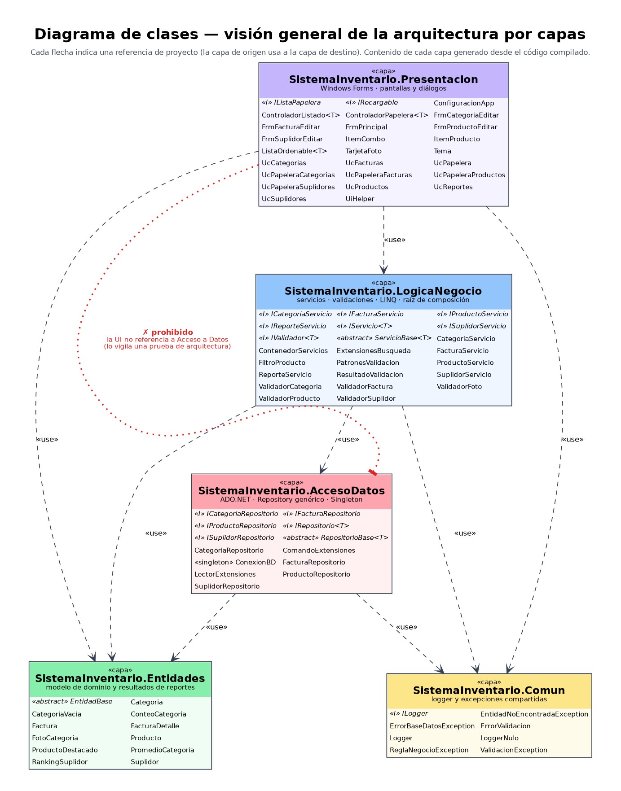
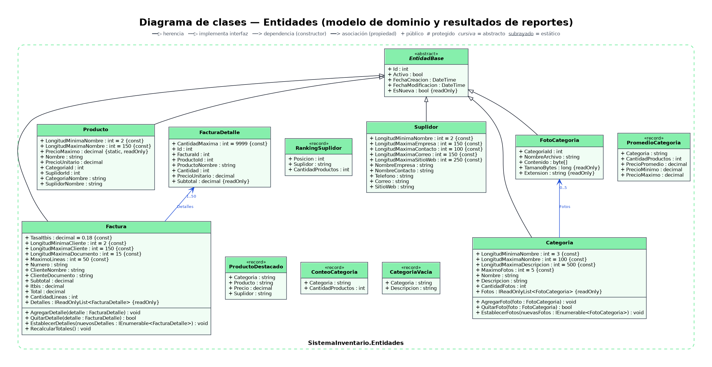
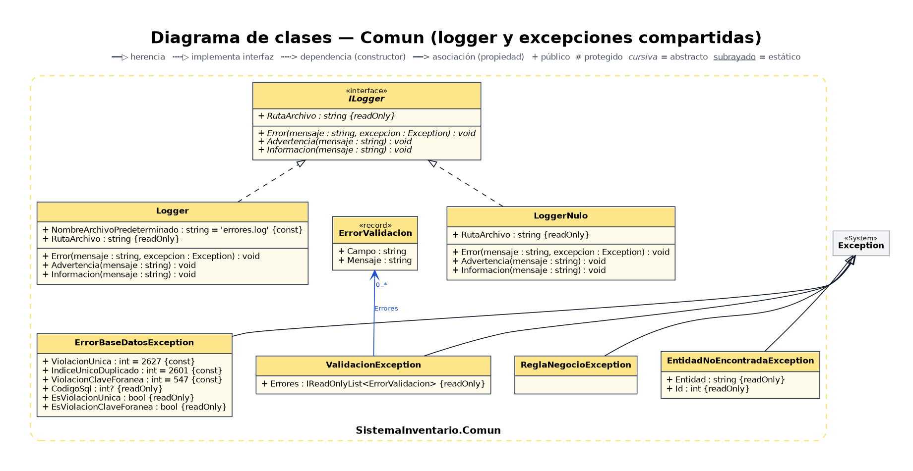
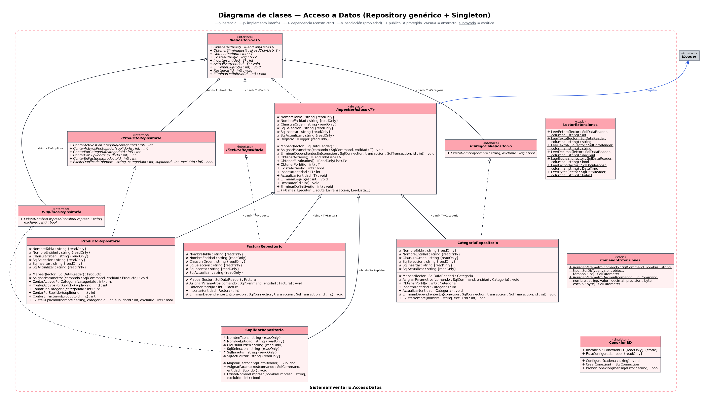
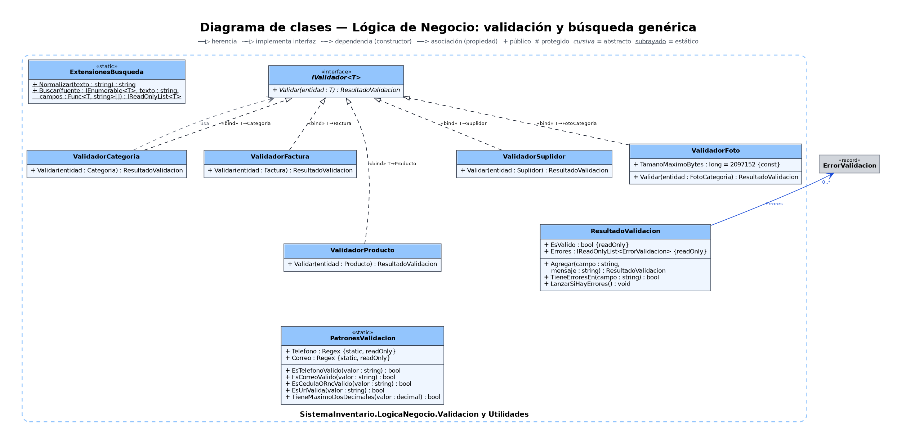
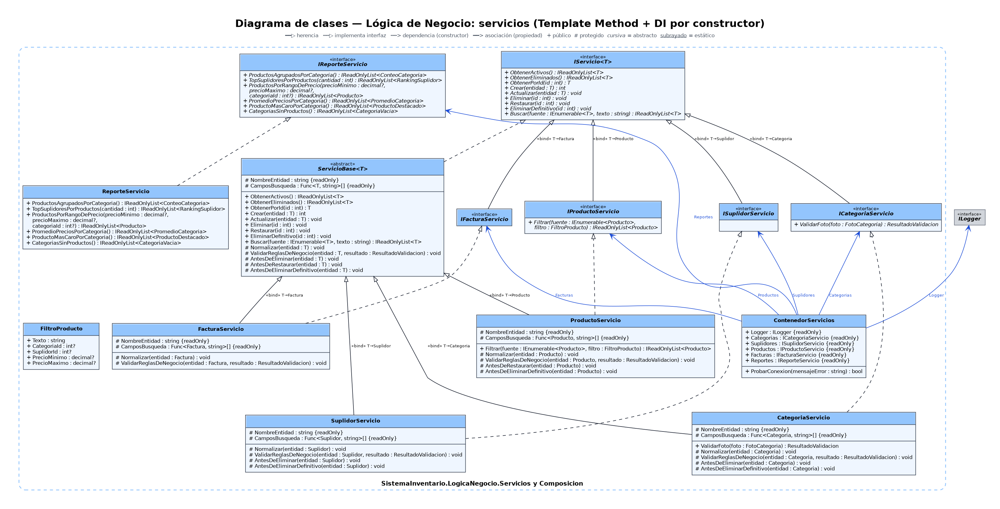
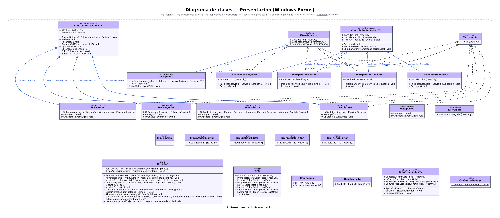

# Diagrama de clases (UML)

Los diagramas se generaron **a partir del código compilado** (por reflexión), no a mano, así que reflejan exactamente las clases,
interfaces, herencia y dependencias que existen en `/src`. Cada imagen está en PNG (para ver o pegar en un documento) y SVG
(vectorial, se puede ampliar sin perder calidad). Los archivos `.dot` de `docs/fuentes/` permiten regenerarlos o editarlos con
[Graphviz](https://graphviz.org/): `dot -Tpng docs/fuentes/diagrama-clases-2-acceso-datos.dot -o salida.png`.

| # | Diagrama | Qué muestra |
|---|---|---|
| 0 | [Visión general](diagrama-clases-0-general.png) | Las 5 capas, su contenido y las dependencias entre proyectos (incluye la regla *Presentación ✗ Acceso a Datos*). |
| 1 | [Entidades](diagrama-clases-1-entidades.png) | `EntidadBase` (abstracta) y sus herederas `Categoria`, `FotoCategoria`, `Suplidor`, `Producto`, `Factura` (con sus líneas `FacturaDetalle`); relaciones `Categoria` 1 — 0..5 `FotoCategoria` y `Factura` 1 — 1..50 `FacturaDetalle`; registros de resultado de los reportes. |
| 1b | [Comun](diagrama-clases-1b-comun.png) | `ILogger` / `Logger` / `LoggerNulo` y la jerarquía de excepciones (`ValidacionException`, `ReglaNegocioException`, `EntidadNoEncontradaException`, `ErrorBaseDatosException`). |
| 2 | [Acceso a Datos](diagrama-clases-2-acceso-datos.png) | **Repository genérico** `IRepositorio<T>` + `RepositorioBase<T>` (Template Method, con `EliminarDefinitivo`), repositorios concretos (incluye `FacturaRepositorio`) con `«bind»` del tipo genérico y el **Singleton** `ConexionBD`. |
| 3 | [Negocio: validación](diagrama-clases-3-negocio-validacion.png) | `IValidador<T>`, los validadores, `ResultadoValidacion`, `PatronesValidacion` (regex) y la búsqueda genérica `ExtensionesBusqueda.Buscar<T>`. |
| 4 | [Negocio: servicios](diagrama-clases-4-negocio-servicios.png) | `IServicio<T>` / `ServicioBase<T>` (Template Method), los servicios concretos, `ReporteServicio` (consultas LINQ) y la raíz de composición `ContenedorServicios`. |
| 5 | [Presentación](diagrama-clases-5-presentacion.png) | Pantallas (listados, facturación, reportes y Papelera), diálogos de edición y los controladores genéricos `ControladorListado<T>` y `ControladorPapelera<T>` que comparten la lógica de listado y de papelera. |

## Diagrama 0 — visión general

## Diagrama 1 — Entidades

## Diagrama 1b — Comun

## Diagrama 2 — Acceso a Datos

## Diagrama 3 — Lógica de Negocio: validación

## Diagrama 4 — Lógica de Negocio: servicios

## Diagrama 5 — Presentación

## Cómo leer los diagramas

- `━━▷` herencia (generalización) · `┅┅▷` implementación de interfaz · `┅┅>` dependencia por constructor · `━━>` asociación.
- `«bind» T→Categoria` indica que una clase o interfaz genérica se usa con ese tipo concreto (por ejemplo, `CategoriaRepositorio` hereda de `RepositorioBase<T>` con `T = Categoria`).
- `+` público · `#` protegido · *cursiva* = abstracto · <u>subrayado</u> = estático.
