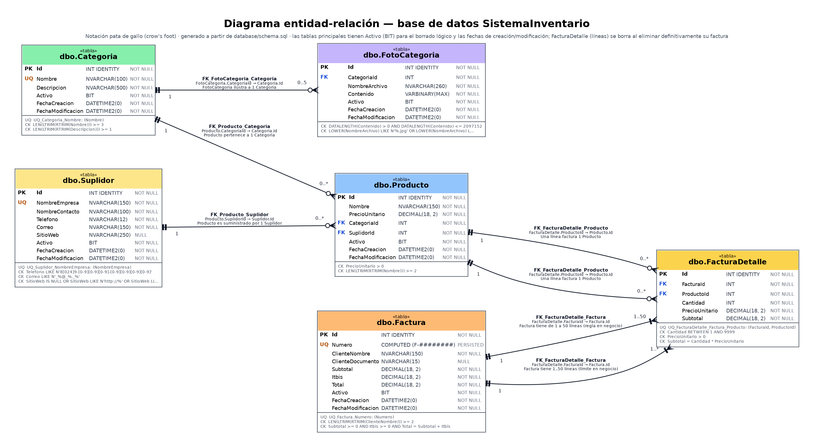

# Diagrama entidad-relación (ER)

El diagrama está en notación de *pata de gallo* y se generó leyendo directamente `database/schema.sql`, de modo que siempre coincide con el esquema real.
Versión vectorial: [diagrama-er.svg](diagrama-er.svg) · fuente editable: [fuentes/diagrama-er.dot](fuentes/diagrama-er.dot) · detalle de columnas: [diccionario-datos.md](diccionario-datos.md).

## Relaciones

| Relación | Cardinalidad | Clave foránea | Regla de negocio asociada |
|---|---|---|---|
| `Categoria` — `Producto` | 1 a 0..* | `FK_Producto_Categoria` (`Producto.CategoriaId`) | La categoría del producto debe estar activa. No se puede eliminar una categoría con productos activos. |
| `Suplidor` — `Producto` | 1 a 0..* | `FK_Producto_Suplidor` (`Producto.SuplidorId`) | El suplidor del producto debe estar activo. No se puede eliminar un suplidor con productos activos. |
| `Categoria` — `FotoCategoria` | 1 a 0..5 | `FK_FotoCategoria_Categoria` (`FotoCategoria.CategoriaId`) | Máximo 5 fotos activas por categoría (validado en la capa de negocio), `.jpg`/`.jpeg`/`.png` de hasta 2 MB. |
| `Factura` — `FacturaDetalle` | 1 a 1..50 | `FK_FacturaDetalle_Factura` (`FacturaDetalle.FacturaId`) | Toda factura necesita al menos una línea y admite como máximo 50 (validado en negocio). Un producto no se repite dentro de la misma factura (`UQ_FacturaDetalle_Factura_Producto`). |
| `Producto` — `FacturaDetalle` | 1 a 0..* | `FK_FacturaDetalle_Producto` (`FacturaDetalle.ProductoId`) | La línea guarda el precio con el que se facturó. Un producto con líneas de factura no se elimina definitivamente. |

## Borrado lógico (soft-delete)

Las tablas `Categoria`, `FotoCategoria`, `Suplidor`, `Producto` y `Factura` tienen `Activo BIT` (1 = activa, 0 = eliminada) y las columnas `FechaCreacion` / `FechaModificacion`. `FacturaDetalle` (las líneas) no tiene borrado lógico: se borra junto con su factura cuando esta se elimina definitivamente.
Eliminar solo cambia `Activo` a 0 y actualiza `FechaModificacion`; la pantalla **Papelera** lista los registros con `Activo = 0` y permite restaurarlos.
